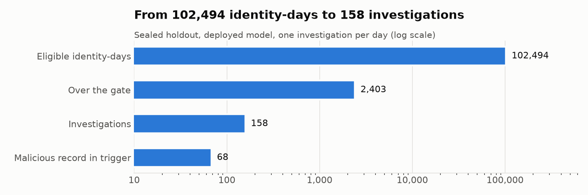
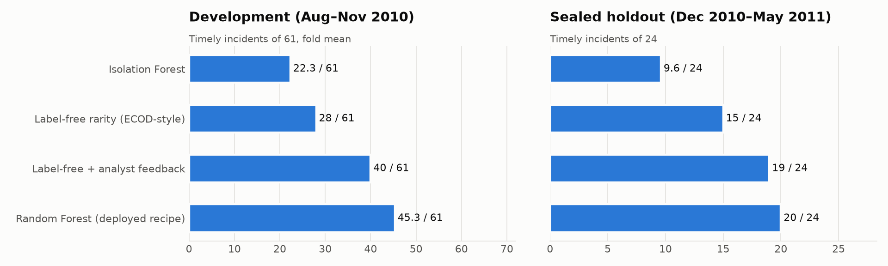
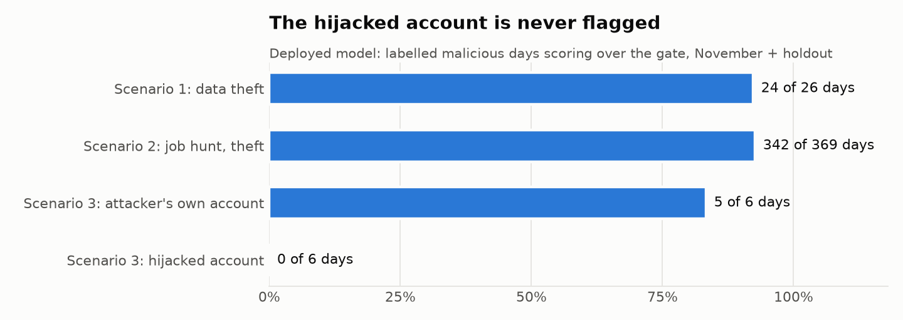

# SentinelID: Behavioral Detection of Identity Misuse Under an Investigation Budget

**Final project report.** Dataset: CERT Insider Threat Test Dataset r4.2 (synthetic). Code, configurations and generated reports are in this repository; every number below is traced to a file in `reports/`, `results.json` or `data/research/`.

---

## Abstract

Attacks that use valid credentials, such as insiders abusing their own access or attackers logging on with stolen credentials, break no access rule, so signature and policy controls do not see them. SentinelID detects them by profiling each identity's behavior against its own lagged history. A security team can investigate only a few people a day, so detection is framed as a **ranking problem with a budget**: each morning at most one identity is admitted for investigation, together with the original log records that support it.

The system replays 14.1 million CERT r4.2 records in time order. It computes 33 causal personal-baseline features per identity-day, scores them with a Random Forest and admits cases through a queue with merging, cooldown and expiry.

- **November 2010 (frozen evaluation):** 31 investigations reached 9 of 11 incidents within 72 hours, against 2 of 11 for an Isolation Forest baseline.
- **Sealed holdout (December 2010 – May 2011):** the frozen model reached 20 of 24 incidents and 16 of 18 insiders it had never seen, with 158 investigations.
- **No labels at the start:** a label-free detector re-weighted by analyst verdicts on the cases it admits rose from 29 to 40 of 61 development incidents.
- **Account takeover:** splitting results by whose account the malicious activity used shows a clear blind spot. The model reaches takeover incidents only through the attacker's own preparation and never flags the hijacked account itself.
- **Population-context features:** added to target that blind spot, they gave a small development gain that reversed on held-out data. The report explains why.

---

## 1. Introduction

### 1.1 Problem

Most security controls ask whether an action is *allowed*. Identity misuse is different, because the credentials are valid and every individual action is permitted. Examples are an employee copying files to USB before resigning, a user uploading documents to an external site, and an administrator logging on as their supervisor with captured credentials. What is wrong is that the behavior is **unusual for that identity**. User and Entity Behavior Analytics (UEBA) addresses this by modelling normal behavior per identity and flagging departures from it.

There is a second constraint: **analyst capacity**. An organisation produces millions of events a day, and a team can investigate a handful of people. A detector that flags every oddity buries the team. The useful question is therefore operational:

> If a team can open one investigation per day, whom should it open, and what evidence supports that choice?

### 1.2 Research questions

- **RQ1.** Can personal-baseline behavioral features and a supervised model put insider incidents in front of an analyst within 72 hours, under a budget of one investigation per day?
- **RQ2.** Does that performance hold on a later period and on insiders the model has never seen?
- **RQ3.** How close does a detector that starts without labels get, and how much of the gap can analyst feedback on admitted cases close?
- **RQ4.** Which stages of an identity attack does the system see, and does it detect a **hijacked account** in use?

### 1.3 Contributions

1. A complete, inspectable detection pipeline: original-record replay, causal features, fixed-model scoring, a budgeted investigation queue, durable cases with evidence pointers back to the original log lines, versioned analyst reviews and a dashboard.
2. An evaluation protocol for a budgeted operation rather than classification accuracy. It uses timely incident reach and investigation yield, a predeclared selection rule, a rolling development backtest and a sealed holdout that was frozen before its labels were read.
3. A label-free detector with analyst-feedback learning in the style of Active Anomaly Discovery, tested with simulated imperfect analysts and wired into the application as an optional mode.
4. An identity-attack coverage analysis that splits results by attack scenario and by account role, plus a predeclared, negative experiment with takeover-aware features.
5. A one-command demo on an invented organisation, and an end-to-end test that runs the real pipeline in CI.

---

## 2. Background and related work

**Benchmark data.** CERT r4.2 was generated to provide realistic, labelled insider-threat data without privacy constraints [1]. It is the standard benchmark in this area, but its users and attacks are simulated; results on it show benchmark detection, not production performance.

**Behavioral representation.** Eldardiry et al. combine activity across domains and compare users with organisational peers [2]. Le and Zincir-Heywood show that representations of change against a user's own history, at day and session granularity, matter more than the classifier [4, 5]. SentinelID follows that line: signed personal percentiles and change magnitudes against a lagged 28-day reference. Peer features were implemented and tested but not deployed (Section 6.2).

**Detectors.** Isolation Forest [3] is the common label-free baseline. ECOD [12] scores rarity from per-feature empirical tails and is parameter-free; SentinelID's best label-free detector is an ECOD-style upper-tail score. Random Forests [11] are the usual supervised choice on CERT [4]. Deep online models [6] and graph or sequence models such as LAN [7] report strong results, but at a different scoring unit and latency; they are future comparators, not baselines here.

**Analyst in the loop.** Das et al.'s Active Anomaly Discovery re-weights an anomaly ensemble from expert verdicts on the instances shown to the expert [8]. That matches the budgeted setting: the only labels a deployment ever gets are verdicts on the cases it chose to investigate.

**Evaluation validity.** Arp et al. list ten pitfalls of machine learning in security, including data snooping, inappropriate baselines, base-rate neglect and lab-only evaluation [9]. Section 7 is organised by them. On rare-positive data, precision–recall summaries are more informative than ROC [10], so ranking quality is reported as average precision (AP).

---

## 3. Threat model

### 3.1 Adversary and assumptions

The adversary holds valid credentials: either their own (an insider) or someone else's, obtained by capture (account takeover). Actions are permitted individually, and detection must come from behavior. The defender sees five activity logs (logon/logoff, removable-device connect, file copy to removable media, email, web) plus monthly directory snapshots (role, team, supervisor). Decisions are made once a day, the morning after activity.

### 3.2 Scenarios in CERT r4.2 and what can see them

Technique IDs are MITRE ATT&CK Enterprise (checked on attack.mitre.org, ATT&CK v20.1, November 2026).

| Scenario | Stage | ATT&CK technique | Log source | Model inputs that can see it |
| --- | --- | --- | --- | --- |
| **1. Data theft before leaving** | After-hours logons by someone who never worked late | T1078 Valid Accounts | logon | after-hours change, timing novelty |
| | Copying to a USB drive for the first time | T1052.001 Exfiltration over USB | device, file | USB and copy change (1, 3, 7 days) |
| | Uploading to wikileaks.org | T1567 Exfiltration Over Web Service | http | web volume change, new hosts/domains |
| **2. Job hunting, then theft** | Weeks of job-site visits | none (a pre-departure indicator) | http | web volume change |
| | Collecting files, then USB use at a markedly higher rate | T1005 Data from Local System; T1052.001 | device, file | USB/copy change and magnitude |
| **3. Account takeover** | Administrator downloads a keylogger | T1105 Ingress Tool Transfer | http | new hosts/domains |
| | Carries it by USB to the supervisor's computer | T1570 Lateral Tool Transfer | device, logon | USB change; logon on a new computer |
| | Keylogger captures the supervisor's keystrokes | T1056.001 Input Capture: Keylogging | not logged | none |
| | Logs on **as the supervisor** and sends alarming mass email | T1078 Valid Accounts (stolen credentials); T1534 Internal Spearphishing is the nearest technique for mail sent from a compromised internal account | logon, email, **under the victim's account** | the victim's own baseline only: timing, email breadth and recipients |

Scenario 3 is the only identity-takeover scenario. Its records fall under **two accounts**: the attacker's own (preparation) and the hijacked supervisor's (misuse). That distinction drives RQ4.

### 3.3 Outside the evidence

CERT has no failed logons, source IP addresses, geolocation, device fingerprints, MFA events or privilege changes. Password spraying, credential stuffing, impossible travel, MFA fatigue and privilege escalation therefore cannot be tested here, and nothing in this report claims coverage of them.

---

## 4. System design

```text
CERT CSVs + monthly LDAP ─▶ ordered replay ─▶ daily identity history ─▶ 33 causal features
      ─▶ Random Forest score ─▶ gate ─▶ budgeted queue (merge · cooldown · expiry)
      ─▶ immutable case + original-record evidence ─▶ analyst review ─▶ (optional) feedback learning
```

- **Ingestion** (`sentinelid/ingestion.py`). Streams the five CSVs and merges them by timestamp and event ID. It rejects timestamp inversions and malformed lines, and attaches the role and team valid in that calendar month. Each record keeps a pointer to its file, byte offset and row, so evidence is always the original line.
- **Behavioral history** (`sentinelid/features.py`). Daily counts per identity, with 1, 3 and 7-day targets compared against 28 reference days that end 7 days earlier. The lag keeps a slow build-up from contaminating its own baseline. An identity-day is scored only after 41 calendar days of history and 7 active reference days.
- **Scoring and admission** (`sentinelid/pipeline.py`). A fixed model scores each closed day. Scores at or above the gate become candidates. At 08:00 the queue admits at most one: the highest pending score. Repeated candidates for one identity merge, an admitted identity enters a 7-day cooldown, and candidates expire after 3 days.
- **Persistence** (`sentinelid/store.py`). SQLite with atomic checkpoints, so an interrupted replay resumes exactly. Cases are immutable, and reviews are versioned with optimistic concurrency.
- **Dashboard** (`dashboard/`, `sentinelid/server.py`). A pipeline overview, an investigation list, and a case view showing the score history, the 33 transformed inputs, the personal references and the original records. A recorded "day replay" steps through November's decisions.
- **Optional adaptive mode** (`sentinelid/adaptive.py`). A label-free detector whose weights are refit from analyst dispositions before each scored day (Section 6.5).
- **Demo root** (`sentinelid/demo.py`). An invented 24-person organisation in the CERT file layout with planted incidents of all three scenario types. `python -m sentinelid demo` runs the real pipeline on it in about 30 seconds.

---

## 5. Method

### 5.1 Features and model

There are 33 inputs: 13 signed personal percentiles and 13 change magnitudes (`log1p`) over USB use, file copies, logons, after-hours activity, external email, message bytes, attachments and web volume, plus 7 novelty and timing inputs (new computers, new recipients, new domains and hosts, unusual hours). The deployed model is a Random Forest with 100 trees, maximum depth 8, minimum leaf size 3, balanced subsample weights and seed 42. It was fitted on 85,688 eligible identity-days from June 8 to October 14, 2010. The gate (0.4056) and the queue policy were selected on earlier development blocks, then frozen.

### 5.2 What is measured

- **Investigation:** one queue admission, used as a stand-in for analyst cost (effort was not measured).
- **Current-positive yield:** the share of investigations whose triggering day contains a labelled malicious record.
- **Timely incident:** an incident counts once if any of its labelled records is shown to an analyst within 72 hours of that record. This is not "detected within 72 hours of onset".
- **Fresh insider:** a holdout incident whose official start is after the holdout begins.
- **Ranking:** average precision (AP) and gate recall on identity-days; these are diagnostics, not the operational result.

### 5.3 Evaluation periods

| Period | Use |
| --- | --- |
| May 1 – June 7, 2010 | History warm-up only |
| June 8 – October 14 | Final fitting of the deployed model |
| November 1–30 | Frozen evaluation of the deployed model (then consumed) |
| August – November | Development backtest: rolling monthly folds, each refit on all earlier days, 3 seeds |
| **December 1, 2010 – May 16, 2011** | **Sealed holdout**: 10.19M records, never used for development. All scorers were fitted and frozen before its labels were read. |

Every experiment declared its candidates and its selection rule in a configuration file (`configs/`) before it ran: "most timely incidents, with no more investigations and no lower yield than the control." The holdout was first used to evaluate the supervised selection. Each later use is labelled an **exploratory reuse** in its report; there have been four.

---

## 6. Results

### 6.1 RQ1: frozen November evaluation

| System | Investigations | Current-positive | Timely incidents |
| --- | ---: | ---: | ---: |
| Random Forest (deployed) | 31 | 21 (68%) | **9 / 11** |
| Isolation Forest (label-free) | 30 | 3 (10%) | 2 / 11 |

Source: `results.json`. The paired actor-cluster bootstrap difference in incident reach was 0.64 (95% interval 0.36–0.91). The predeclared matched-cost criterion was still **missed**, because the RF used one more investigation than the comparator, so the formal verdict is "improvement not established". The RF also uses training labels and the Isolation Forest does not.

### 6.2 Development backtest: no variant beats the deployed recipe

Seventeen supervised candidates varied features, model family and queue policy ([report](reports/BACKTEST.md)). None beat the deployed recipe's 45.3/61 timely incidents under the rule:

- Correcting a known chronology defect in a 3-day target: 44.3.
- Adding peer features: 41.0.
- HistGradientBoosting: 45.7, but with more investigations.
- Ranking by persistence, a 3-day cooldown and a 5-day expiry all reduced reach.

**Of 15 development misses, 12 were queue losses** (expiry, cooldown, late admission) rather than scores below the gate. The detector usually ranks the insider high enough; the binding constraint is the budget.

### 6.3 RQ2: sealed holdout

| Scorer | Investigations | Yield | Timely incidents | Fresh insiders | AP |
| --- | ---: | ---: | ---: | ---: | ---: |
| Deployed RF (frozen, fitted June–October) | 158 | 0.43 | **20 / 24** | **16 / 18** | 0.82 |
| Isolation Forest (refit, 5 seeds) | 164–168 | 0.04–0.08 | 7–12 / 24 | 6–10 / 18 | 0.05 |
| `ecod_up_top5` label-free (exploratory reuse) | 163 | 0.11 | 15 / 24 | 12 / 18 | 0.07 |

Sources: [HOLDOUT.md](reports/HOLDOUT.md), [HOLDOUT-UNSUPERVISED.md](reports/HOLDOUT-UNSUPERVISED.md). Gate recall was 93% and the median time from official incident onset to the timely admission was 49 hours. The model generalised to insiders whose incidents started after it was frozen.



*Figure 1. The sealed holdout as a funnel. 2.3% of identity-days pass the gate; the one-per-day budget then admits 158, of which 68 contain a malicious record on the triggering day.* A secondary HistGradientBoosting comparator that had tied in development fell to AP 0.60, so its development tie was noise.

### 6.4 RQ3a: detection without labels

Twenty-three label-free variants were tried over three rounds ([report](reports/BACKTEST-UNSUPERVISED.md)). The best, `ecod_up_top5`, makes inputs one-sided (only *more* activity is suspicious), scores each input's upper-tail rarity against the reference population, and sums the day's five largest. It raised development reach from 22.3 (Isolation Forest) to **28.0/61**. That is a real improvement, but far below supervised detection (45.3).

### 6.5 RQ3b: analyst feedback closes much of the gap

Starting from `ecod_up_top5` with no labels, each day's admitted case receives a verdict from a simulated analyst. Non-negative weights on the 34 rarity components are then refit with logistic loss and an L2 pull toward the label-free prior. Unadmitted days never produce labels ([report](reports/FEEDBACK.md)).

| Variant (August–November, one continuous queue) | Timely incidents | Investigations | Yield |
| --- | ---: | ---: | ---: |
| No learning (control) | 29 / 61 | 120 | 0.28 |
| Feedback, λ = 3 | 34 / 61 | 87 | 0.78 |
| **Feedback, λ = 0.3** | **40 / 61** | 102 | 0.69 |
| Supervised RF (fold backtest, for scale) | 45.3 / 61 | 123 | 0.73 |

- The predeclared success criterion (beat the control without lowering yield) was met. The paired sign test for λ = 0.3 gave p = 0.035; two λ values were tried, so this is weak evidence.
- **Imperfect analysts** (10 seeds each): with 10% of verdicts flipped, the learner averaged 38.2 and beat the control in 10/10 seeds. With 20% flipped it averaged 34.7 (9/10), and with 30% of true positives missed, 32.8 (7/10).
- **Holdout continuation** (exploratory reuse): 19/24 incidents and 16/18 fresh insiders with 82–83 investigations, against the frozen RF's 20/24 and 16/18 with 158.
- The learned weights moved from USB/copy rarity toward web-volume change, new domains and hosts, and message bytes.



*Figure 2. Timely incident reach by detector. The holdout feedback figure is an exploratory continuation of the development run.*

The same scorer runs in the application as `replay --new --adaptive`. Each saved review re-weights the scores from the next day.

### 6.6 RQ4: identity-attack coverage

Splitting the deployed model's already-reported results by scenario and account role ([report](reports/IDENTITY_COVERAGE.md)):

| Period | Scenario | Account | Labelled days over the gate | Incidents reached in time |
| --- | --- | --- | ---: | ---: |
| November | 1 | own | 4 / 5 | 1 / 3 |
| November | 2 | own | 78 / 88 | 7 / 7 |
| November | 3 | attacker's own | 1 / 2 | 1 / 1 |
| November | 3 | **hijacked (victim's)** | **0 / 2** | **0 / 1** |
| Holdout | 1 | own | 20 / 21 | 7 / 9 |
| Holdout | 2 | own | 264 / 281 | 11 / 13 |
| Holdout | 3 | attacker's own | 4 / 4 | 2 / 2 |
| Holdout | 3 | **hijacked (victim's)** | **0 / 4** | **0 / 2** |



*Figure 3. Share of labelled malicious days scoring over the gate, by scenario and account (November and holdout combined).*

The re-measurement reproduces the published totals exactly (31 investigations and 9/11; 158 and 20/24). The finding: **the model sees the insider stages well, and sees the takeover only through the attacker's preparation** (the keylogger download, the USB use and the logon on another person's computer). **No day on a hijacked account ever passed the gate.** This is the expected weakness of personal-baseline profiling. The attacker using the victim's account produces only a short, modest change in the *victim's* history, and nothing in a per-identity model links that change to the attacker.

### 6.7 Takeover-aware features: a predeclared negative result

The final experiment added population context from a one-pass ledger over the raw HTTP, email and logon records (`sentinelid/ledger.py`, [backtest](reports/BACKTEST-LEDGER.md), [holdout](reports/HOLDOUT-LEDGER.md)):

- destinations almost nobody else visits;
- job-site visits;
- email recipient breadth;
- logons on a computer owned by another identity;
- **exposure**: other identities' logons on one's own computer in the last 3 days. This is the one input that links an attacker to the account they hijack.

All features are causal. Candidates and rule were declared before any result, and the configuration discloses that the ideas came from inspecting development labels.

| Candidate | Development (61 incidents) | Holdout incidents (24) | Holdout fresh insiders (18) |
| --- | ---: | ---: | ---: |
| Corrected control | 44.3 | 19.6 | 15.2 |
| Exposure only | 43.3 | – | – |
| `ledger_generic` (selected by the rule) | 45.0 | 18.0 | 13.8 |

The controls reproduced the earlier backtest exactly, so the new features changed nothing else. The selected candidate's development gain (+0.7, inside the seed range) **reversed on the holdout**, and hijacked-account reach stayed at zero for every candidate. Added to the label-free detector, the ledger features lowered reach from 28 to 23.

The diagnosis is the base rate. Exposure *does* fire on hijacked days: its magnitude is at least 1.0 on 10 of the 15 hijacked development days. It also fires on 2,604 of 114,895 ordinary days, because CERT users often log on to each other's computers. A signal with roughly 0.4% precision cannot win a queue that admits one identity a day, and about 15 labelled days are too few for a forest to learn the combination that would make it specific. Per the stop rule, nothing was retuned after the results.

### 6.8 System verification

- The saved replay processed 14,143,645 records and produced 18,772 scores and 31 cases. The research pipeline reproduces the deployed model's November and holdout results exactly.
- `tests/test_end_to_end.py` runs the real ingestion, features, model, queue and store on the invented demo organisation in CI. It checks cross-source ordering, rejection of inverted sources, retrieval of evidence from the original lines, that every planted November incident reaches a case (the takeover through the attacker's account, as in CERT), and that an interrupted and resumed replay equals an uninterrupted one **bit for bit**. That last check caught a nondeterminism in the demo model's parallel prediction, which is now fixed.
- **Adaptive application against the research harness** ([report](reports/ADAPTIVE_APP_CHECK.md)). The real application replayed all 14.1M records in adaptive mode over November from a cold start. A simulated analyst saved a review on each case, and the replay read those reviews before the next scored day. It admitted **the same 23 investigations, in the same order, on the same mornings** as the research harness. All 33 inputs agreed on all 18,772 scored identity-days. Scores were close but not identical (largest difference 0.063 against day gates of 7–26). The difference traces to the label-free reference population: on every Monday from June to October, the live feature builder counts one more new host, recipient or domain than the archived research cache, for about 30 identities each. That affects 820 of 96,123 reference rows; November rows match exactly. The cause was not traced further.

---

## 7. Threats to validity

Organised by the pitfalls of Arp et al. [9].

| Pitfall | Where it applies | Mitigation and residual risk |
| --- | --- | --- |
| P1 Sampling bias | CERT is one synthetic organisation with scripted insiders | Claims are limited to the benchmark. A real organisation's noise and attacker behavior will differ. |
| P2 Label inaccuracy | Labels are exact here; real analyst verdicts are not | Imperfect-analyst runs (Section 6.5) bound the effect for feedback learning. |
| P3 Data snooping | The deployed model's features were chosen on earlier development data; the ledger ideas came from inspecting labels | A sealed holdout was frozen before its labels were read. The ledger round disclosed its origin and failed on the holdout. |
| P4 Spurious correlations | A forest may key on artefacts of the generator or on recurring actors | Two November incidents recur from the fitting period; the holdout's fresh-insider count measures generalisation to insiders never seen in training. |
| P5 Biased parameter selection | Gate, queue and λ were chosen on development data | All were frozen before the holdout; two λ values were tried and disclosed. |
| P6 Inappropriate baseline | A weak baseline flatters the model | Isolation Forest was compared at matched cost, plus a stronger label-free detector (`ecod_up_top5`) and feedback learning. |
| P7 Inappropriate measures | Accuracy is meaningless at this base rate | Operational measures (timely reach, yield, investigations) and AP are used. |
| P8 Base-rate fallacy | 1 in 170 eligible identity-days is malicious in development, 1 in 330 in the holdout | Budgeted admission makes false-alarm cost explicit; Section 6.7 is a base-rate failure analysed directly. |
| P9 Lab-only evaluation | Replay of a fixed dataset; analyst simulated | Evidence and workflow are real, but there is no live deployment and analyst effort was not measured. |
| P10 Inappropriate threat model | Claiming coverage of attacks the data cannot show | Section 3.3 lists what is untestable; the takeover result is reported as a blind spot. |

**Holdout reuse.** The holdout was used once for selection-independent evaluation, then four more times for exploratory comparisons. Numbers from those later uses are weaker evidence than the first, and a further independent period would be needed for any new claim.

---

## 8. Limitations and future work

**Limitations.**

- The data is synthetic.
- The analyst is simulated and always available.
- An investigation stands in for effort that was not measured.
- Incident counts are small: 11 in November, 61 incident-folds in development, 24 in the holdout.
- The model is frozen with no drift monitoring.
- The dashboard is local and unauthenticated.
- The system profiles identities one at a time, which is the root of the takeover blind spot.

**Future work, in order of value for identity-attack detection:**

1. **Data with authentication context** (sign-in logs with source address, device and MFA outcome). It would cover the credential-attack stages CERT cannot express.
2. **Linking cases across identities.** When an investigation shows an identity on another person's computer, raise the owner's next days for review. This attacks the takeover blind spot with a specific rule rather than a weak population feature.
3. **Named signals on each case** ("logged on to another identity's computer", "first USB use", "upload to a destination nobody else visits"), so an analyst sees *why* as well as *what*.
4. **Real analyst feedback**, with effort and disagreement measured.
5. **Sequence or graph models** [6, 7], compared under the same queue and protocol.

---

## 9. Reproducing the results

```bash
python3.14 -m venv .venv && .venv/bin/python -m pip install -r requirements.txt
.venv/bin/python -m unittest discover -s tests -q          # includes the end-to-end demo run
.venv/bin/python -m sentinelid demo                         # one minute, invented data, no CERT
```

The full benchmark needs the CERT data (about 7 GB; review its terms first):

```bash
.venv/bin/python -m sentinelid setup --accept-data-license [--holdout]
.venv/bin/python -m sentinelid replay && .venv/bin/python -m sentinelid serve
.venv/bin/python -m sentinelid research extract|backtest|holdout|feedback|ledger|coverage
```

Answer labels and archived training inputs are a local recovery archive, not part of the public clone; the research stages that read labels need it. See [README](README.md), [ARCHITECTURE](ARCHITECTURE.md) and [EXPERIMENT_HISTORY](EXPERIMENT_HISTORY.md).

---

## Appendix A. How the design got here

Each stage changed the design because of a measured failure of the previous one. Detailed records are in [EXPERIMENT_HISTORY.md](EXPERIMENT_HISTORY.md).

1. **Rules, then hourly classification.** The first system was a small rule set over logon, USB and copy events. A supervised Random Forest scored active identity-hours. On August 1–14, rules reached 4 true positives with 12 false; the forest 10 with 37. Both missed every one of 111 scenario 2 hours. An always-negative classifier scored **99.53% accuracy**, which is why accuracy is not reported anywhere in this project. Better hourly ranking also did not produce better investigations under a budget.
2. **Daily history and evidence-aware admission.** Moving to calendar days, multi-day targets, email and web measurements and a case queue let an Isolation Forest reach 9 of 10 October incidents, but with 60 investigations against the rules' 12. More coverage at a higher cost is not an improvement, and that led to matched-cost evaluation. Inspecting evidence also exposed a schema defect: the dataset's email column is `attachments`, not `attachment_count`. Ingestion now accepts only explicit aliases and rejects missing or conflicting values.
3. **Representation for a budget.** Percentiles against one's own history saturate, because many extreme days share the top rank. Pairing each signed percentile with a change magnitude keeps the size of the departure. This percentile-plus-magnitude representation with a Random Forest became the deployed model, frozen before November.
4. **Consolidation.** The code was reduced to a small package with reproducible, checksum-pinned acquisition. Historical work moved to a verified local archive.
5. **Independent evidence.** The sealed holdout, label-free detectors, feedback learning and the identity-coverage round followed (Sections 6.2–6.7).

---

## References

1. J. Glasser and B. Lindauer. Bridging the Gap: A Pragmatic Approach to Generating Insider Threat Data. *IEEE Security and Privacy Workshops*, 2013, pp. 98–104. doi:10.1109/SPW.2013.37.
2. H. Eldardiry, E. Bart, J. Liu, J. Hanley, B. Price and O. Brdiczka. Multi-Domain Information Fusion for Insider Threat Detection. *IEEE Security and Privacy Workshops*, 2013. doi:10.1109/SPW.2013.14.
3. F. T. Liu, K. M. Ting and Z.-H. Zhou. Isolation Forest. *ICDM*, 2008, pp. 413–422. doi:10.1109/ICDM.2008.17.
4. D. C. Le, N. Zincir-Heywood and M. I. Heywood. Analyzing Data Granularity Levels for Insider Threat Detection Using Machine Learning. *IEEE TNSM* 17(1), 2020, pp. 30–44. doi:10.1109/TNSM.2020.2967721.
5. D. C. Le and N. Zincir-Heywood. Anomaly Detection for Insider Threats Using Unsupervised Ensembles. *IEEE TNSM* 18(2), 2021, pp. 1152–1164. doi:10.1109/TNSM.2021.3071928.
6. A. Tuor, S. Kaplan, B. Hutchinson, N. Nichols and S. Robinson. Deep Learning for Unsupervised Insider Threat Detection in Structured Cybersecurity Data Streams. *AAAI Workshop on AI for Cyber Security*, 2017. arXiv:1710.00811.
7. X. Cai, Y. Wang, S. Xu, H. Li, Y. Zhang, Z. Liu and X. Yuan. LAN: Learning Adaptive Neighbors for Real-Time Insider Threat Detection. arXiv:2403.09209, 2024.
8. S. Das, W.-K. Wong, T. Dietterich, A. Fern and A. Emmott. Incorporating Expert Feedback into Active Anomaly Discovery. *ICDM*, 2016.
9. D. Arp, E. Quiring, F. Pendlebury, A. Warnecke, F. Pierazzi, C. Wressnegger, L. Cavallaro and K. Rieck. Dos and Don'ts of Machine Learning in Computer Security. *USENIX Security Symposium*, 2022.
10. T. Saito and M. Rehmsmeier. The Precision-Recall Plot Is More Informative than the ROC Plot When Evaluating Binary Classifiers on Imbalanced Datasets. *PLoS ONE* 10(3): e0118432, 2015.
11. L. Breiman. Random Forests. *Machine Learning* 45(1), 2001, pp. 5–32.
12. Z. Li, Y. Zhao, X. Hu, N. Botta, C. Ionescu and G. H. Chen. ECOD: Unsupervised Outlier Detection Using Empirical Cumulative Distribution Functions. *IEEE Transactions on Knowledge and Data Engineering*, 2022. arXiv:2201.00382.

*Dataset: CERT Insider Threat Test Dataset, CMU Software Engineering Institute; Copyright © 2011 ExactData, LLC. Its terms restrict redistribution.*
