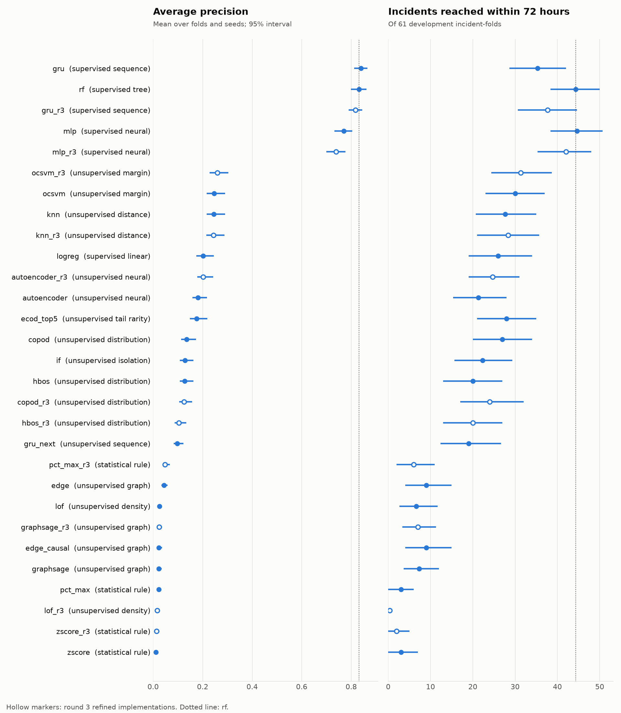

# Methods study: detection methods compared

Development folds August to November 2010 (expanding training window from 2010-06-08), feature set `c`, gate at the 0.99 quantile of each method's training scores, the maintained one-a-day queue. Specification, fixed before any result: [docs/methods-study.md](../docs/methods-study.md), declared in commits `f09cf91` (round 1), `0504970` (round 2), `4f868e5` (round 3), each before its round ran. The holdout is not used. Intervals are 95% paired bootstrap intervals (incident-folds for reach, test days for average precision); the baseline is `rf`.

## Ranking and reach (61 incident-folds)

| Method | Family | Avg. precision [95%] | vs RF [95%] | ROC-AUC | Incidents reached [95%] | vs RF [95%] |
| --- | --- | ---: | ---: | ---: | ---: | ---: |
| `rf` | supervised tree | 0.832 [0.799, 0.862] | — | 0.990 | 44.3 [38.3, 50.0] | — |
| `if` | unsupervised isolation | 0.129 [0.107, 0.163] | -0.703 [-0.734, -0.659] worse | 0.937 | 22.3 [15.7, 29.3] | -22.0 [-30.3, -13.0] worse |
| `ecod_top5` | unsupervised tail rarity | 0.176 [0.149, 0.219] | -0.656 [-0.687, -0.610] worse | 0.953 | 28.0 [21.0, 35.0] | -16.3 [-25.7, -7.7] worse |
| `mlp` | supervised neural | 0.770 [0.732, 0.804] | -0.062 [-0.082, -0.043] worse | 0.970 | 44.7 [38.3, 50.7] | +0.3 [-4.7, +5.7] matches |
| `autoencoder` | unsupervised neural | 0.181 [0.159, 0.218] | -0.650 [-0.682, -0.608] worse | 0.957 | 21.3 [15.3, 28.0] | -23.0 [-30.3, -15.0] worse |
| `gru` | supervised sequence | 0.840 [0.812, 0.866] | +0.008 [-0.023, +0.041] matches | 0.992 | 35.3 [28.7, 42.0] | -9.0 [-15.0, -3.7] worse |
| `gru_next` | unsupervised sequence | 0.097 [0.083, 0.122] | -0.734 [-0.764, -0.695] worse | 0.942 | 19.0 [12.3, 26.7] | -25.3 [-34.0, -16.3] worse |
| `edge` | unsupervised graph | 0.044 [0.034, 0.059] | -0.787 [-0.821, -0.748] worse | 0.728 | 9.0 [4.0, 15.0] | -35.3 [-43.0, -27.3] worse |
| `graphsage` | unsupervised graph | 0.023 [0.016, 0.035] | -0.808 [-0.840, -0.773] worse | 0.550 | 7.3 [3.7, 12.0] | -37.0 [-43.7, -29.7] worse |
| `zscore` | statistical rule | 0.011 [0.010, 0.017] | -0.820 [-0.850, -0.786] worse | 0.663 | 3.0 [0.0, 7.0] | -41.3 [-48.0, -33.7] worse |
| `pct_max` | statistical rule | 0.023 [0.021, 0.026] | -0.808 [-0.838, -0.777] worse | 0.841 | 3.0 [0.0, 6.0] | -41.3 [-47.7, -34.7] worse |
| `hbos` | unsupervised distribution | 0.128 [0.108, 0.162] | -0.704 [-0.735, -0.661] worse | 0.940 | 20.0 [13.0, 27.0] | -24.3 [-33.3, -15.3] worse |
| `copod` | unsupervised distribution | 0.135 [0.113, 0.173] | -0.696 [-0.729, -0.652] worse | 0.925 | 27.0 [20.0, 34.0] | -17.3 [-26.0, -8.7] worse |
| `lof` | unsupervised density | 0.026 [0.021, 0.035] | -0.806 [-0.836, -0.771] worse | 0.818 | 6.7 [2.7, 11.7] | -37.7 [-44.0, -31.3] worse |
| `knn` | unsupervised distance | 0.245 [0.216, 0.291] | -0.586 [-0.621, -0.540] worse | 0.968 | 27.7 [20.7, 35.0] | -16.7 [-25.0, -8.7] worse |
| `ocsvm` | unsupervised margin | 0.246 [0.216, 0.291] | -0.586 [-0.622, -0.540] worse | 0.962 | 30.0 [23.0, 37.0] | -14.3 [-22.3, -6.7] worse |
| `logreg` | supervised linear | 0.202 [0.175, 0.245] | -0.629 [-0.658, -0.590] worse | 0.921 | 26.0 [19.0, 34.0] | -18.3 [-25.7, -11.0] worse |
| `edge_causal` | unsupervised graph | 0.023 [0.016, 0.036] | -0.808 [-0.840, -0.770] worse | 0.647 | 9.0 [4.0, 15.0] | -35.3 [-43.0, -27.3] worse |
| `zscore_r3` | statistical rule | 0.014 [0.013, 0.017] | -0.817 [-0.847, -0.785] worse | 0.736 | 2.0 [0.0, 5.0] | -42.3 [-48.3, -35.7] worse |
| `pct_max_r3` | statistical rule | 0.048 [0.040, 0.067] | -0.783 [-0.810, -0.747] worse | 0.855 | 6.0 [2.0, 11.0] | -38.3 [-45.0, -31.0] worse |
| `hbos_r3` | unsupervised distribution | 0.104 [0.087, 0.134] | -0.727 [-0.757, -0.687] worse | 0.928 | 20.0 [13.0, 27.0] | -24.3 [-33.0, -15.0] worse |
| `copod_r3` | unsupervised distribution | 0.125 [0.105, 0.158] | -0.707 [-0.736, -0.666] worse | 0.931 | 24.0 [17.0, 32.0] | -20.3 [-29.3, -11.3] worse |
| `lof_r3` | unsupervised density | 0.017 [0.015, 0.021] | -0.815 [-0.844, -0.782] worse | 0.771 | 0.3 [0.0, 1.0] | -44.0 [-49.7, -38.0] worse |
| `knn_r3` | unsupervised distance | 0.244 [0.215, 0.288] | -0.587 [-0.621, -0.542] worse | 0.967 | 28.3 [21.0, 35.7] | -16.0 [-24.0, -8.0] worse |
| `ocsvm_r3` | unsupervised margin | 0.260 [0.228, 0.304] | -0.572 [-0.606, -0.526] worse | 0.956 | 31.3 [24.3, 38.7] | -13.0 [-20.7, -5.3] worse |
| `autoencoder_r3` | unsupervised neural | 0.202 [0.179, 0.242] | -0.630 [-0.660, -0.586] worse | 0.958 | 24.7 [19.0, 31.0] | -19.7 [-26.7, -12.3] worse |
| `mlp_r3` | supervised neural | 0.739 [0.700, 0.777] | -0.093 [-0.116, -0.072] worse | 0.945 | 42.0 [35.3, 48.0] | -2.3 [-7.7, +3.0] matches |
| `gru_r3` | supervised sequence | 0.817 [0.789, 0.845] | -0.015 [-0.046, +0.020] matches | 0.969 | 37.7 [30.7, 44.7] | -6.7 [-13.0, -0.3] worse |
| `graphsage_r3` | unsupervised graph | 0.025 [0.017, 0.037] | -0.807 [-0.840, -0.770] worse | 0.607 | 7.0 [3.3, 11.3] | -37.3 [-44.0, -30.3] worse |

## Budget curves and queue cost

Recall at k is the share of malicious identity-days ranked in the top k of their own day (before the gate and queue). Investigations and current-positive yield are through the queue.

| Method | Recall@1 | Recall@2 | Recall@5 | Recall@10 | Over gate | Investigations | Yield |
| --- | ---: | ---: | ---: | ---: | ---: | ---: | ---: |
| `rf` | 0.190 | 0.361 | 0.726 | 0.850 | 791 | 122.0 | 73% |
| `if` | 0.075 | 0.116 | 0.180 | 0.258 | 807 | 128.0 | 21% |
| `ecod_top5` | 0.068 | 0.120 | 0.243 | 0.354 | 790 | 124.0 | 29% |
| `mlp` | 0.180 | 0.345 | 0.691 | 0.805 | 715 | 124.3 | 69% |
| `autoencoder` | 0.078 | 0.134 | 0.241 | 0.383 | 895 | 128.7 | 23% |
| `gru` | 0.184 | 0.352 | 0.714 | 0.911 | 848 | 116.0 | 72% |
| `gru_next` | 0.061 | 0.093 | 0.148 | 0.217 | 862 | 128.7 | 17% |
| `edge` | 0.015 | 0.036 | 0.063 | 0.129 | 14011 | 130.0 | 8% |
| `graphsage` | 0.015 | 0.027 | 0.049 | 0.077 | 837 | 126.0 | 6% |
| `zscore` | 0.002 | 0.008 | 0.025 | 0.030 | 958 | 129.0 | 3% |
| `pct_max` | 0.030 | 0.038 | 0.049 | 0.101 | 11938 | 130.0 | 4% |
| `hbos` | 0.068 | 0.118 | 0.203 | 0.304 | 786 | 127.0 | 19% |
| `copod` | 0.072 | 0.112 | 0.224 | 0.297 | 766 | 128.0 | 23% |
| `lof` | 0.012 | 0.021 | 0.043 | 0.068 | 782 | 124.7 | 6% |
| `knn` | 0.093 | 0.156 | 0.316 | 0.507 | 841 | 129.0 | 28% |
| `ocsvm` | 0.092 | 0.158 | 0.314 | 0.485 | 937 | 128.7 | 29% |
| `logreg` | 0.074 | 0.137 | 0.283 | 0.445 | 701 | 128.0 | 26% |
| `edge_causal` | 0.015 | 0.030 | 0.046 | 0.078 | 618 | 126.0 | 7% |
| `zscore_r3` | 0.000 | 0.002 | 0.008 | 0.025 | 971 | 127.0 | 2% |
| `pct_max_r3` | 0.036 | 0.046 | 0.072 | 0.103 | 884 | 126.0 | 6% |
| `hbos_r3` | 0.053 | 0.091 | 0.181 | 0.245 | 789 | 126.0 | 17% |
| `copod_r3` | 0.061 | 0.108 | 0.190 | 0.283 | 734 | 126.0 | 21% |
| `lof_r3` | 0.001 | 0.002 | 0.030 | 0.066 | 742 | 125.0 | 0% |
| `knn_r3` | 0.084 | 0.156 | 0.294 | 0.487 | 794 | 129.0 | 28% |
| `ocsvm_r3` | 0.090 | 0.160 | 0.317 | 0.485 | 882 | 127.7 | 31% |
| `autoencoder_r3` | 0.083 | 0.146 | 0.264 | 0.416 | 858 | 127.0 | 25% |
| `mlp_r3` | 0.181 | 0.342 | 0.676 | 0.764 | 703 | 124.7 | 68% |
| `gru_r3` | 0.187 | 0.360 | 0.717 | 0.875 | 777 | 112.7 | 76% |
| `graphsage_r3` | 0.018 | 0.021 | 0.049 | 0.077 | 905 | 124.3 | 6% |

## Reach by scenario

Mean incident-folds reached within 72 hours per scenario; for the takeover (scenario 3), split by the attacker's own account and the hijacked account.

| Method | Scenario 1 | Scenario 2 | Scenario 3 | Takeover: attacker | Takeover: hijacked |
| --- | ---: | ---: | ---: | ---: | ---: |
| `rf` | 11.3 | 30.0 | 3.0 | 3.0 | 0.0 |
| `if` | 9.0 | 10.7 | 2.7 | 2.7 | 0.0 |
| `ecod_top5` | 8.0 | 18.0 | 2.0 | 2.0 | 0.0 |
| `mlp` | 13.3 | 27.3 | 4.0 | 4.0 | 0.0 |
| `autoencoder` | 11.3 | 10.0 | 0.0 | 0.0 | 0.0 |
| `gru` | 6.3 | 28.0 | 1.0 | 1.0 | 0.0 |
| `gru_next` | 9.7 | 6.7 | 2.7 | 2.0 | 0.7 |
| `edge` | 3.0 | 2.0 | 4.0 | 4.0 | 1.0 |
| `graphsage` | 4.0 | 0.0 | 3.3 | 3.3 | 0.0 |
| `zscore` | 2.0 | 1.0 | 0.0 | 0.0 | 0.0 |
| `pct_max` | 1.0 | 2.0 | 0.0 | 0.0 | 0.0 |
| `hbos` | 7.0 | 11.0 | 2.0 | 2.0 | 0.0 |
| `copod` | 9.0 | 15.0 | 3.0 | 3.0 | 0.0 |
| `lof` | 0.0 | 6.7 | 0.0 | 0.0 | 0.0 |
| `knn` | 12.3 | 12.3 | 3.0 | 3.0 | 0.0 |
| `ocsvm` | 12.3 | 14.7 | 3.0 | 3.0 | 0.0 |
| `logreg` | 8.0 | 16.0 | 2.0 | 2.0 | 0.0 |
| `edge_causal` | 3.0 | 1.0 | 5.0 | 5.0 | 1.0 |
| `zscore_r3` | 2.0 | 0.0 | 0.0 | 0.0 | 0.0 |
| `pct_max_r3` | 5.0 | 1.0 | 0.0 | 0.0 | 0.0 |
| `hbos_r3` | 6.0 | 11.0 | 3.0 | 3.0 | 0.0 |
| `copod_r3` | 8.0 | 13.0 | 3.0 | 3.0 | 0.0 |
| `lof_r3` | 0.0 | 0.3 | 0.0 | 0.0 | 0.0 |
| `knn_r3` | 13.0 | 11.7 | 3.7 | 3.7 | 0.0 |
| `ocsvm_r3` | 12.7 | 14.7 | 4.0 | 4.0 | 0.0 |
| `autoencoder_r3` | 12.0 | 10.7 | 2.0 | 2.0 | 0.0 |
| `mlp_r3` | 12.7 | 25.7 | 3.7 | 3.7 | 0.0 |
| `gru_r3` | 9.3 | 27.0 | 1.3 | 1.3 | 0.0 |
| `graphsage_r3` | 3.0 | 0.7 | 3.3 | 3.3 | 0.0 |

## Timeliness

Hours from an incident's first labelled record (own account) to the first investigation showing one, pooled over folds and seeds; incidents never shown are left out. Ranking measures reward a malicious day ranked high on any day of an incident; reach needs it early.

| Method | Scenario 1: shown, median h, after 72 h | Scenario 2 | Scenario 3 |
| --- | ---: | ---: | ---: |
| `rf` | 38/51, 34 h, 29% | 90/117, 48 h, 42% | 9/15, 66 h, 0% |
| `if` | 37/51, 30 h, 46% | 33/117, 168 h, 88% | 8/15, 22 h, 0% |
| `ecod_top5` | 11/17, 30 h, 45% | 18/39, 123 h, 61% | 2/5, 33 h, 0% |
| `mlp` | 42/51, 32 h, 29% | 82/117, 43 h, 30% | 12/15, 56 h, 0% |
| `autoencoder` | 38/51, 28 h, 21% | 35/117, 70 h, 46% | 0/15 |
| `gru` | 35/51, 122 h, 77% | 84/117, 70 h, 43% | 3/15, 42 h, 0% |
| `gru_next` | 44/51, 134 h, 59% | 20/117, 199 h, 70% | 9/15, 66 h, 33% |
| `edge` | 3/17, 125 h, 67% | 2/39, 192 h, 50% | 4/5, 23 h, 0% |
| `graphsage` | 12/51, 29 h, 17% | 0/117 | 10/15, 24 h, 0% |
| `zscore` | 3/17, 73 h, 67% | 1/39, 43 h, 0% | 0/5 |
| `pct_max` | 1/17, 30 h, 0% | 2/39, 43 h, 0% | 0/5 |
| `hbos` | 9/17, 30 h, 44% | 11/39, 168 h, 73% | 2/5, 23 h, 0% |
| `copod` | 12/17, 87 h, 58% | 15/39, 186 h, 87% | 3/5, 24 h, 0% |
| `lof` | 7/51, 393 h, 100% | 20/117, 301 h, 75% | 0/15 |
| `knn` | 48/51, 110 h, 56% | 42/117, 83 h, 50% | 9/15, 22 h, 0% |
| `ocsvm` | 47/51, 125 h, 62% | 46/117, 117 h, 52% | 10/15, 23 h, 10% |
| `logreg` | 12/17, 64 h, 50% | 16/39, 115 h, 69% | 2/5, 45 h, 0% |
| `edge_causal` | 3/17, 125 h, 67% | 1/39, 23 h, 0% | 5/5, 23 h, 0% |
| `zscore_r3` | 3/17, 61 h, 33% | 0/39 | 0/5 |
| `pct_max_r3` | 8/17, 88 h, 50% | 1/39, 237 h, 100% | 0/5 |
| `hbos_r3` | 8/17, 22 h, 38% | 11/39, 186 h, 82% | 3/5, 42 h, 0% |
| `copod_r3` | 11/17, 98 h, 55% | 13/39, 307 h, 85% | 4/5, 33 h, 25% |
| `lof_r3` | 0/51 | 1/117, 525 h, 100% | 0/15 |
| `knn_r3` | 48/51, 124 h, 62% | 35/117, 166 h, 63% | 11/15, 48 h, 0% |
| `ocsvm_r3` | 48/51, 122 h, 67% | 44/117, 130 h, 64% | 12/15, 23 h, 0% |
| `autoencoder_r3` | 42/51, 29 h, 29% | 34/117, 73 h, 59% | 6/15, 54 h, 0% |
| `mlp_r3` | 41/51, 31 h, 32% | 79/117, 43 h, 30% | 11/15, 23 h, 0% |
| `gru_r3` | 41/51, 61 h, 49% | 81/117, 69 h, 41% | 4/15, 54 h, 0% |
| `graphsage_r3` | 9/51, 53 h, 0% | 2/117, 499 h, 100% | 10/15, 22 h, 0% |

## Round 3: refined implementations against the originals

Each refinement is described in the specification. The gate guard fired in 0 of 100 round 3 runs.

| Original | Refined | Incidents reached | Change | Avg. precision | Change | Over gate |
| --- | --- | ---: | ---: | ---: | ---: | ---: |
| `zscore` | `zscore_r3` | 3.0 → 2.0 | -1.0 | 0.011 → 0.014 | +0.003 | 958 → 971 |
| `pct_max` | `pct_max_r3` | 3.0 → 6.0 | +3.0 | 0.023 → 0.048 | +0.025 | 11938 → 884 |
| `hbos` | `hbos_r3` | 20.0 → 20.0 | +0.0 | 0.128 → 0.104 | -0.024 | 786 → 789 |
| `copod` | `copod_r3` | 27.0 → 24.0 | -3.0 | 0.135 → 0.125 | -0.010 | 766 → 734 |
| `lof` | `lof_r3` | 6.7 → 0.3 | -6.3 | 0.026 → 0.017 | -0.009 | 782 → 742 |
| `knn` | `knn_r3` | 27.7 → 28.3 | +0.7 | 0.245 → 0.244 | -0.001 | 841 → 794 |
| `ocsvm` | `ocsvm_r3` | 30.0 → 31.3 | +1.3 | 0.246 → 0.260 | +0.014 | 937 → 882 |
| `autoencoder` | `autoencoder_r3` | 21.3 → 24.7 | +3.3 | 0.181 → 0.202 | +0.021 | 895 → 858 |
| `mlp` | `mlp_r3` | 44.7 → 42.0 | -2.7 | 0.770 → 0.739 | -0.031 | 715 → 703 |
| `gru` | `gru_r3` | 35.3 → 37.7 | +2.3 | 0.840 → 0.817 | -0.023 | 848 → 777 |
| `graphsage` | `graphsage_r3` | 7.3 → 7.0 | -0.3 | 0.023 → 0.025 | +0.002 | 837 → 905 |

5 of 11 refinements reached more incidents than their original, and no refined method changed its reading against `rf`. The comparison between families does not depend on these implementation choices.

## Expectations against outcomes

Expectations were written into the specification before each round ran. "Near" is read as within 5 incident-folds of reach; that tolerance was chosen when writing this report, not declared.

| Round | Expectation | Held |
| ---: | --- | --- |
| 1 | `mlp` matches or trails `rf` | yes |
| 1 | `autoencoder` and `gru_next` land near `if` and `ecod_top5`, far below the supervised methods | yes |
| 1 | `gru` matches `rf` | partly: `gru` matches on average precision (the expectation did not name a measure) |
| 1 | Graph methods rank lower than the behavioural detectors and do not reach the hijacked account | **no** |
| 2 | `zscore` and `pct_max` land at or below the unsupervised detectors (AP under 0.2) | yes |
| 2 | `hbos` and `copod` land near `ecod_top5` | **no** |
| 2 | `lof` and `knn` land near `if`; `ocsvm` near `autoencoder` | **no** |
| 2 | `logreg` trails `rf` on average precision | yes |
| 2 | `edge_causal` admits far fewer rows than `edge` and stays well below the behavioural detectors | yes |
| 3 | `zscore_r3` and `pct_max_r3` improve on their originals but stay below the unsupervised detectors | **no** |
| 3 | At least four of the six upward-only variants improve their reach | **no** |
| 3 | `mlp_r3` and `gru_r3` stay within the interval of `rf` | partly: `mlp_r3` matches on reach; `gru_r3` matches on average precision (the expectation did not name a measure) |
| 3 | `gru_r3` keeps its reach deficit | yes |
| 3 | `graphsage_r3` improves on `graphsage`, stays well below the behavioural detectors, and reaches the hijacked account at most once | **no** |

## Identity reading

Hijacked-account incident-folds reached within 72 hours, as a mean over seeds:

- Methods that score the 33 personal-baseline inputs (23 variants): `gru_next` (0.7).
- Graph methods, which score *which* computers and web domains an identity touches (4 variants): `edge` (1.0), `edge_causal` (1.0).

Comparing an identity with its own past almost never reaches the account in use by someone else. The few hits come from scoring unfamiliar computer and domain edges, or from the next-day sequence model, and each of those methods reaches far fewer insider incidents. With this few hijacked incident-folds, it is a lead for linking identities (an attacker's logon on another person's computer), not a detector.

Reading rule (fixed in the specification): a method matches the baseline when the interval of its difference contains 0, and is better or worse when the whole interval is above or below 0. With 28 comparisons a single better or worse is a lead, not a finding.
